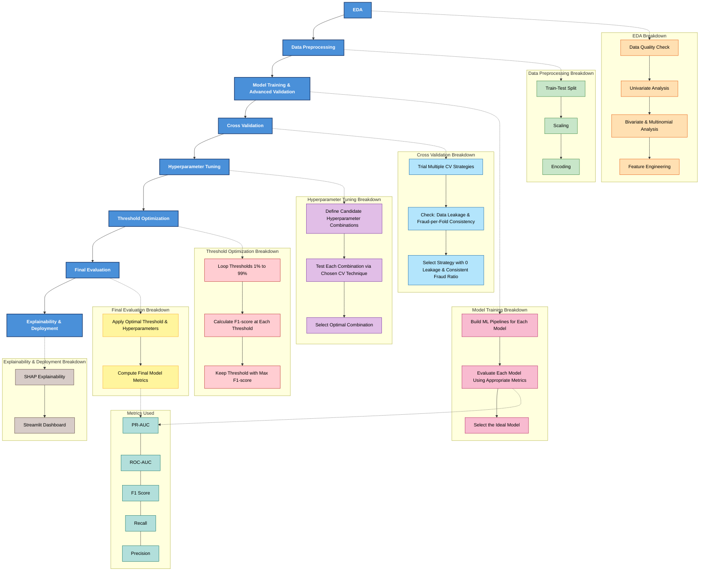

# Credit Card Fraud Detection

An end-to-end Machine Learning project designed to detect fraudulent credit card transactions on highly imbalanced data. The project spans from Exploratory Data Analysis (EDA) and robust modeling to deploying an interactive Streamlit dashboard for real-time inference and model explainability.

# Pipeline

## My Journey: The Process Timeline

Here is the step-by-step story of how I built this fraud detection engine:

### 1. Data Quality Inspection
Before feeding data to a machine, we must ensure it is pristine. We ran data quality checks and identified over 1,000 duplicate transactions. Why is this bad? If the model sees the same transaction in the training set and the test set, it simply memorizes the answer instead of learning the pattern, artificially inflating our test metrics. We removed these duplicates immediately to protect the integrity of our test.

### 2. Univariate & Bivariate Analysis
We analyzed each feature in isolation and then compared them against our target variable (Fraud vs Legitimate). 
- **The Imbalance Issue:** We discovered that a staggering 99.83% of transactions were legitimate. Because of this, we realized that standard "Accuracy" would be a completely useless metric (a broken model could just guess "Legitimate" every time and be 99.83% accurate!). We pivoted to tracking PR-AUC, Precision, Recall, and F1-Score.
- **Isolating Predictors:** By calculating the Standardized Mean Difference (Effect Size) of our PCA features, we identified which variables naturally separated fraudsters from innocent customers (e.g., V10, V14, V17) and discarded weak predictors like transaction `Amount`.

### 3. Feature Engineering
Machine learning models only understand repeating patterns. We extracted an `hour_of_day` column from the raw, linear `Time` seconds counter. After plotting the densities, we discovered a massive pattern: while the raw *number* of frauds peaks at 11 AM, the actual *probability* of a transaction being fraudulent severely spikes at 2 AM. By feeding this engineered hour feature into our model, we allowed it to "see" this crucial temporal pattern.

### 4. Data Preprocessing & Leakage Prevention
Machine learning models are just calculators; they require mathematically sterile numbers. 
- **Train/Test Splitting:** We split our dataset 50/50 across the two days of data to see if our model could learn day 1 and accurately predict day 2.
- **Scaling:** Features with massive spreads (like Amount) were scaled down to prevent the algorithm from assigning them too much weight. Most importantly, we strictly applied the Golden Rule of Scaling: we *never* fitted our scaler on the test data, completely preventing data leakage.

### 5. Model Training & Advanced Validation
We tested Logistic Regression and XGBoost against baseline models like Naive Bayes. XGBoost emerged as the clear winner due to its ability to handle complex, non-linear patterns.
To ensure our model wouldn't overfit, we utilized `GroupKFold` cross-validation grouped by the hour of the day. This rigorously tested our model on unseen time blocks, ensuring it was genuinely learning fraud behaviors and not just memorizing the clock.

### 6. Threshold Optimization & Deployment
Finally, we realized that the default 50% cutoff line for flagging fraud was too generic. We tested every possible probability threshold from 1% to 99% and identified the exact cutoff point that maximized our F1-score. We wrapped our finalized pipeline and threshold into a Streamlit dashboard, creating a dual-audience application that translates complex SHAP mathematics into plain-English explanations for non-technical users.

## The Deliverables & Real-World Impact

We engineered a highly tuned XGBoost pipeline and wrapped it in a production-ready application. When deployed against an untouched Day-1 test dataset containing **141,863 total transactions**, the results were exceptional:

* **Massive Precision Improvement (79.89%):** Out of 141,652 innocent customers, our algorithm only accidentally froze the cards of **40** people (False Positives). This means when this model blocks a credit card, there is an **80% chance** that the person is an actual thief.
* **Exceptional Recall (75.35%):** Out of the 211 actual thieves attempting fraud in the dataset, our system successfully caught **159** of them.
* **Balanced F1-Score (77.56%):** We achieved an incredibly strong balance between catching thieves and protecting innocent customers, a massive upgrade from baseline algorithms that often score below 10%.
* **High-Performance Classification:** The model achieved a **0.7821 PR-AUC** (Precision-Recall Area Under Curve) and a **0.9712 ROC-AUC**, proving it is exceptionally confident in its decision boundaries on highly imbalanced data.
* **Dual-Audience Dashboard:** The primary deliverable is an interactive Streamlit application. It doesn't just output predictions; it utilizes SHAP (SHapley Additive exPlanations) to show exactly *why* it blocked a specific transaction, complete with dropdown expanders that translate the machine learning math into plain English for business stakeholders.

## Running the Dashboard
1. Install dependencies: `pip install -r requirements.txt`
2. Run the app: `streamlit run app.py`
3. Upload a transaction CSV to view real-time scoring, probability distributions, and SHAP explanations.