```mermaid
graph TD
    %% Node Styling
    classDef start_end fill:#2ecc71,stroke:#27ae60,stroke-width:2px,color:white;
    classDef phase fill:#3498db,stroke:#2980b9,stroke-width:2px,color:white;
    classDef decision fill:#f1c40f,stroke:#f39c12,stroke-width:2px,color:black;
    classDef action fill:#e74c3c,stroke:#c0392b,stroke-width:2px,color:white;
    
    A([Start: Raw Dataset]):::start_end --> B[Phase 1: Data Quality & Inspection]:::phase
    
    B --> C{Missing<br>Values?}:::decision
    C -->|Yes| D[Impute or Drop<br/>Depending on % and Domain]:::action
    C -->|No| E{Incorrect<br>Data Types?}:::decision
    D --> E
    E -->|Yes| F[Convert Types<br/>e.g., String to Datetime]:::action
    E -->|No| G[Phase 2: Univariate Analysis]:::phase
    F --> G
    
    G --> H[Analyze Distributions<br/>Histograms, Bar Charts]
    H --> I{Extreme<br>Outliers?}:::decision
    I -->|Yes| J[Cap, Transform, or Drop<br/>Wait! Are they fraud? Keep them!]:::action
    I -->|No| K[Phase 3: Bivariate/Multivariate Analysis]:::phase
    J --> K
    
    K --> L[Feature Correlations<br/>Scatter Plots, Heatmaps]
    L --> M{High<br>Multicollinearity?}:::decision
    M -->|Yes| N[Drop Redundant Features<br/>or use PCA]:::action
    M -->|No| O[Phase 4: Feature Engineering]:::phase
    N --> O
    
    O --> P[Create New Features<br/>e.g., hour_of_day from Time]
    P --> Q{Class<br>Imbalance?}:::decision
    Q -->|Yes| R[Plan for Class Weights,<br/>SMOTE, or PR-AUC metrics]:::action
    Q -->|No| S([End EDA: Ready for Modeling!]):::start_end
    R --> S
```

# 📓 The Definitive EDA Playbook

This document serves as a comprehensive, step-by-step master guide for conducting Exploratory Data Analysis (EDA) on any tabular dataset. It breaks down the 4 core phases, detailing exactly what you are looking for, how to identify it, what it means for your machine learning models, and how to fix it.

---

---

## Phase 1: Data Quality & Inspection (The Sanity Check)

Before you do any math, you must ensure the data is structurally sound.

### 1. Missing Values (NaNs)
* **What am I looking for?** Blank cells, `NaN` (Not a Number), or placeholder values (like `-999` or `"Unknown"`).
* **What do I see?** Running `df.isnull().sum()` or `df.info()` shows that the number of non-null entries is less than the total rows. 
* **What does this mean for me?** Most Scikit-Learn models (Logistic Regression, SVMs, etc.) will **crash** if you pass them NaNs. XGBoost can handle NaNs internally, but it's best practice to be intentional about them.
* **How do I fix it?** 
  * If a column is 90% missing: Drop the column entirely (`df.drop()`).
  * If a row is missing the Target variable: Drop the row.
  * If a numerical column is missing 5%: Impute it with the Median (resilient to outliers) or Mean.
  * If it's categorical: Impute with the Mode (most frequent) or create a new category called "Missing".

### 2. Incorrect Data Types
* **What am I looking for?** Columns stored as the wrong data type (e.g., prices stored as strings like `"$1,200"`, or dates stored as plain text `"2023-01-01"`).
* **What do I see?** `df.info()` shows the data type as `object` (string) when you know it should be `float64` or `datetime64`.
* **What does this mean for me?** You cannot do math on strings. Models only accept numeric matrices.
* **How do I fix it?** 
  * Use string manipulation to strip characters (`df['price'].str.replace('$', '')`).
  * Cast types using `df['col'].astype(float)` or `pd.to_datetime()`.

### 3. Duplicated Data
* **What am I looking for?** Identical rows across all columns.
* **What do I see?** `df.duplicated().sum()` returns a number > 0.
* **What does this mean for me?** Duplicates artificially inflate the importance of certain records. More dangerously, if a duplicate exists in both your training set and test set, you have **Data Leakage** (your model cheats by having seen the test data during training).
* **How do I fix it?** Run `df.drop_duplicates(inplace=True)`.

---

## Phase 2: Univariate Analysis (One Variable at a Time)

Here, you isolate each feature to understand its individual distribution.

### 1. Numerical Skewness
* **What am I looking for?** How the data is spread out. Is it a perfect bell curve (Normal Distribution), or is it heavily skewed to the left or right?
* **What do I see?** Plotting a histogram (`sns.histplot`) shows a long tail trailing off to the right (like income data—most people make average amounts, but billionaires drag the tail to the right).
* **What does this mean for me?** Linear models (Linear Regression, Logistic Regression) and Neural Networks assume data is somewhat normally distributed. Highly skewed data messes up their weights. Tree-based models (XGBoost, Random Forest) don't care about skewness.
* **How do I fix it?** Apply a Log Transformation (`np.log1p(df['col'])`) to squash the long tail and make it look more like a normal distribution.

### 2. Extreme Outliers
* **What am I looking for?** Values that are insanely far away from the rest of the data (e.g., a transaction for $1,000,000 when the average is $50).
* **What do I see?** A Boxplot (`sns.boxplot`) shows dots plotted way outside the "whiskers".
* **What does this mean for me?** Outliers pull the "mean" (average) heavily in their direction. If you use standard scaling, an outlier will crush all your normal data into a tiny range.
* **How do I fix it?** 
  * **Domain Knowledge is key here.** Is the outlier an error? (Drop it). Is it a legitimate extreme case? (Keep it). In Fraud Detection, the outliers are often the fraud itself!
  * If you must handle them: Use **RobustScaler** (which scales based on medians, ignoring outliers) or Winsorize (cap the outliers at the 99th percentile).

### 3. High Cardinality (Categorical Features)
* **What am I looking for?** Categorical columns with hundreds or thousands of unique text values (like Zip Codes or IP Addresses).
* **What do I see?** `df['zip_code'].nunique()` returns 15,000.
* **What does this mean for me?** If you use One-Hot Encoding on this, you will create 15,000 new columns. This causes the "Curse of Dimensionality" (your dataset blows up in size, eating RAM and ruining model performance).
* **How do I fix it?** 
  * Group rare values into an "Other" bucket.
  * Use Target Encoding (replace the zip code with the historical average fraud rate for that zip code).

---

## Phase 3: Bivariate & Multivariate Analysis (Relationships)

Here, you compare features against each other, and against your target variable.

### 1. Feature-to-Target Relationship (Predictive Power)
* **What am I looking for?** Does this feature actually help me predict my target?
* **What do I see?** 
  * For Numerical vs. Categorical Target: Grouped Boxplots (`sns.boxplot(x='Fraud', y='Amount')`). If the boxes look identical, the feature isn't helping. If the boxes are at completely different heights, it's a strong predictor!
* **What does this mean for me?** If a feature has zero relationship with the target, it is "noise". Noise confuses models and makes them overfit.
* **How do I fix it?** Drop useless features.

### 2. Feature-to-Feature Relationship (Multicollinearity)
* **What am I looking for?** Two independent features that are highly correlated with *each other* (e.g., "Years of Experience" and "Age").
* **What do I see?** A Correlation Heatmap (`sns.heatmap(df.corr())`) shows a correlation > 0.85 between two features.
* **What does this mean for me?** It provides redundant information. In linear models, multicollinearity makes feature importance coefficients wildly unstable and uninterpretable.
* **How do I fix it?** 
  * Keep the one that is more correlated with the target variable, and drop the other one.
  * Alternatively, combine them using PCA (Principal Component Analysis).

---

## Phase 4: Feature Engineering & Imbalance Handling

### 1. Class Imbalance (The Fraud Problem)
* **What am I looking for?** A target variable where one class vastly outnumbers the other.
* **What do I see?** `df['Target'].value_counts(normalize=True)` shows 99.8% Legitimate (0) and 0.2% Fraud (1).
* **What does this mean for me?** The Accuracy Paradox. A model can just predict "0" every single time and achieve 99.8% accuracy, but it will have a 0% Recall for Fraud. The model learns to completely ignore the minority class.
* **How do I fix it?**
  * **Algorithm Level:** Pass `class_weight='balanced'` to Logistic Regression, or use `scale_pos_weight` in XGBoost. This penalizes the model heavily for missing a fraud case.
  * **Data Level:** Oversample the minority class synthetically (SMOTE) or Undersample the majority class.
  * **Evaluation Level:** NEVER use Accuracy. Use Precision, Recall, F1-Score, and PR-AUC.

### 2. Deriving New Features
* **What am I looking for?** Ways to combine existing columns mathematically to expose stronger signals to the model.
* **What does this mean for me?** Models are smart, but they can't magically invent complex human concepts unless you help them.
* **How do I fix it?** 
  * Turn a raw timestamp into `hour_of_day` or `is_weekend`.
  * Divide `Transaction Amount` by `Account Balance` to create a `Utilization Ratio`.
  * Calculate "Transaction Velocity" (how many transactions did this user make in the last 60 minutes?).
